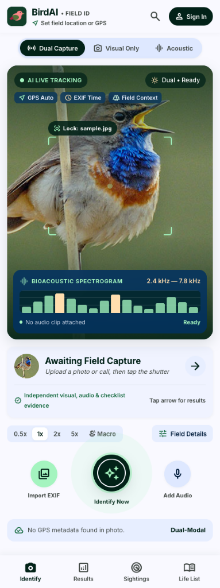
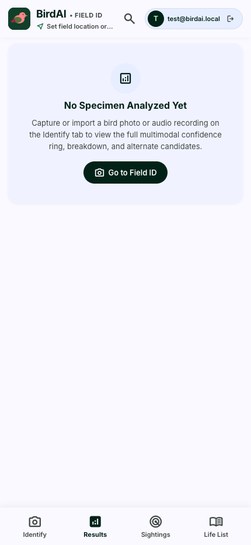
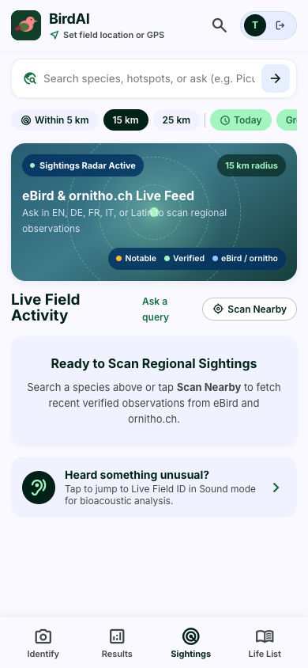
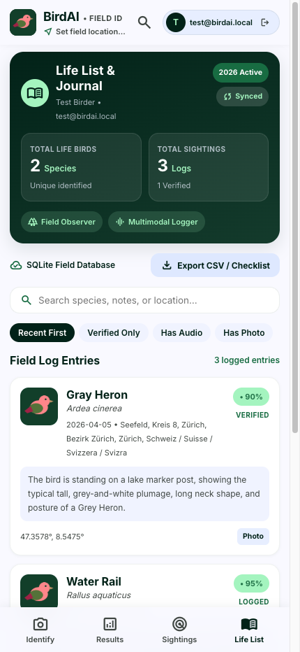

# BirdAI

BirdAI is a context-aware embodied bird perception and observation review system. It combines field birdwatching with practical machine perception: comparing uncertain observations from camera and audio sources, exposing transparent confidence and evidence, and helping an observer learn from them.

---

## Core Principles

- **Uncertainty & Evidence Over Labels**: Rather than returning a single overconfident label, BirdAI provides ranked candidate species alongside an explicit evidence breakdown (visual features, audio call patterns, and regional checklist plausibility).
- **Merlin Audio Candidates Are Not Ground Truth**: Audio recordings from Merlin Bird ID are supported, but Merlin's suggested species is modeled as an *unverified external prior*, allowing the user to inspect whether the recording actually supports it.
- **Data Discipline & Uncalibrated Scores**: Model confidence scores are explicitly documented and displayed as uncalibrated heuristic estimates rather than empirical probabilities.
- **Human Verification Loop**: Every observation can be reviewed, confirmed, or corrected by the user. Saved observations form an empirical evaluation and learning set.
- **Mobile-First & Desktop Responsive (Google Stitch)**: Designed using [Google Stitch](https://stitch.google.com/) with a naturalist color scheme, touch-friendly camera/audio capture on mobile, and a side-by-side evidence workbench on desktop.

---

## UI Preview (Stitch — Live Field ID)

<table>
  <tr>
    <td align="center" width="25%">
      <br>
      <sub><b>Identify</b> — Live Field ID viewfinder, HUD telemetry &amp; bioacoustic spectrogram</sub>
    </td>
    <td align="center" width="25%">
      <br>
      <sub><b>Results</b> — Multimodal visual, audio &amp; checklist evidence</sub>
    </td>
    <td align="center" width="25%">
      <br>
      <sub><b>Sightings</b> — Natural-language eBird &amp; ornitho.ch radar</sub>
    </td>
    <td align="center" width="25%">
      <br>
      <sub><b>Life List</b> — Saved observations &amp; verified ground truth</sub>
    </td>
  </tr>
</table>

---

## Color Palette & Design System

The web client follows the **Stitch "BirdAI - Live Field ID"** color system with `Inter` typography and `Material Symbols Outlined` icons:

| Token | Hex | Role |
| :--- | :--- | :--- |
| **Primary (Deep Forest)** | `#022218` | Primary buttons, active mode pill, tactile shutter, high-contrast headers |
| **Secondary (Field Emerald)** | `#186c42` | Verified status badges, GPS indicators, active focus states |
| **Secondary Fixed (Mint)** | `#a4f4bf` | Confidence match pills, reticle lock corners, bioacoustic bars |
| **Surface** | `#f9f9ff` | App canvas, glassmorphic top header &amp; bottom navigation bar |
| **Surface Container** | `#e7eeff` / `#f0f3ff` | Match result drawer, evidence cards, zoom &amp; control strips |
| **Inverse Surface (HUD)** | `#003060` | Viewfinder environmental chips &amp; bioacoustic spectrogram overlay |

Detailed Stitch design prompts and component specifications are documented in [`docs/stitch/prompt_guide.md`](docs/stitch/prompt_guide.md).

---

## Architecture Overview

```
                      ┌────────────────────────────────────────┐
                      │        Responsive Web Client           │
                      │  Mobile (PWA / Touch) & Desktop UI     │
                      └──────────────────┬─────────────────────┘
                                         │  HTTP / JSON
                                         ▼
                      ┌────────────────────────────────────────┐
                      │          FastAPI Service (:8080)       │
                      │    /api/observations, /correct, /docs  │
                      └───────┬────────────────────────┬───────┘
                              │                        │
               ┌──────────────▼──────────┐   ┌─────────▼──────────────┐
               │    Perception Engine    │   │  Local Storage Layer   │
               │  • Gemini 2.5 Flash VLM │   │  • data/uploads/{id}/  │
               │  • Audio Property Insp. │   │  • data/observations/  │
               │  • Merlin Prior Parser  │   │  • Verification State  │
               │  • eBird Context Prior  │   └─────────┬──────────────┘
               │  • Optional Classifier  │             │
               └─────────────────────────┘             │
                                                       ▼
                                             ┌──────────────────┐
                                             │ Evaluation Suite │
                                             │ Top-k, MRR, Brier│
                                             └──────────────────┘
```

---

## Quickstart

### 1. Prerequisites & Environment Setup

Copy `.env.example` to `.env` and add your API keys:

```bash
cp .env.example .env
```

Edit `.env`:
```bash
GEMINI_API_KEY=your_gemini_api_key_here
EBIRD_API_KEY=your_ebird_api_key_here
# Optional Stitch MCP API key:
STITCH_API_KEY=your_stitch_api_key_here
```

### 2. Local Python Development

Requires **Python 3.14** (the same version as the Docker images; see `.python-version`).
Install dependencies (runtime + test/lint tools) and start the service:

```bash
pip install -r requirements-dev.txt
PYTHONPATH=src uvicorn birdai.api.app:app --host 0.0.0.0 --port 8080 --reload
```

- **Web App**: Open [http://localhost:8080](http://localhost:8080)
- **Interactive REST Docs (Swagger)**: Open [http://localhost:8080/docs](http://localhost:8080/docs)

---

## Running with OrbStack (macOS) or Docker

On macOS, **[OrbStack](https://orbstack.dev/)** is the recommended container engine, offering near-instant startup, native volume performance, and drop-in compatibility with the standard Docker CLI.

### Container Concepts

- **Building an Image** (`docker compose build`): Packages Python, system dependencies from `requirements.txt`, application code from `src/`, and default assets into a reproducible, isolated image.
- **Running a Container** (`docker compose up`): Launches an isolated execution instance of that image. Port mapping (`8080:8080`) routes localhost traffic directly into the container, while the volume mount (`./data:/app/data`) ensures that saved observations and uploaded images/audio persist on your host machine across container restarts.

### Commands

Build and start the container stack:

```bash
# Build the BirdAI container image
docker compose build

# Start the service in the foreground
docker compose up
```

Once running, navigate to [http://localhost:8080](http://localhost:8080).

---

## Evaluation Workflow

A central contribution of BirdAI is reliable, reproducible evaluation over real-world observations with human-verified labels.

### Running the Evaluator

Evaluate against the included benchmark dataset (`data/evaluation_samples/seed_benchmark.json`) or the observations you've recorded in the app database (`DATABASE_URL`, default `data/birdai.db`). Only observations you've confirmed or corrected in the app are scored.

```bash
# Run against seed benchmark
PYTHONPATH=src python scripts/evaluate.py --benchmark data/evaluation_samples/seed_benchmark.json

# Run against all users' verified observations in the database
PYTHONPATH=src python scripts/evaluate.py

# Only one user's observations, or a different database
PYTHONPATH=src python scripts/evaluate.py --user you@example.com
PYTHONPATH=src python scripts/evaluate.py --database-url sqlite:///path/to/other.db
```

Legacy JSON observations in `data/observations/` must be imported first with `scripts/migrate_json_to_db.py`.

### Reported Metrics

1. **Top-1 & Top-k Accuracy**: Proportion of observations where the verified true species matches the top prediction or appears in the top-k candidates.
2. **Mean Reciprocal Rank (MRR)**: Evaluates ranking quality across candidate lists ($1/\text{rank}$).
3. **Modality Breakdown**: Separate performance tracking for image-only, audio-only, and multimodal submissions.
4. **Merlin Prior Performance**: Evaluates how often Merlin's external suggestion was correct vs. incorrect.
5. **Calibration Analysis**: Groups predictions into confidence bins (`0-49%`, `50-74%`, `75-100%`) and compares average model confidence against actual empirical accuracy.

---

## API Endpoints

| Method | Endpoint | Description |
| :--- | :--- | :--- |
| `POST` | `/api/observations` | Ingest image, audio, context, and optional Merlin suggestion |
| `GET` | `/api/observations/{id}` | Inspect observation details, candidates, and evidence breakdown |
| `POST` | `/api/observations/{id}/correct` | Submit verified ground truth or species correction |
| `GET` | `/api/observations` | List saved observations with optional `?reviewed_only=true` filter |
| `GET` | `/api/media/{id}/{file}` | Stream uploaded image or audio file |
| `GET` | `/health` | Service health status |

---

## Testing

Run the automated test suite and linter:

```bash
PYTHONPATH=src pytest
ruff check .
```

### Continuous Integration

GitHub Actions (`.github/workflows/ci.yml`) runs on every push and pull request to `master`:

1. **Lint & test**: `ruff` and `pytest` on Python 3.14 (from `.python-version`), with no API keys set, so tests can never hit real Gemini or eBird.
2. **Docker build**: builds the app image (not pushed), checks `/health` responds, and fails if a `.env` or database file ended up inside the image.

The classifier image isn't built in CI yet because its checkpoint isn't stored in git. There's no deployment step yet.
