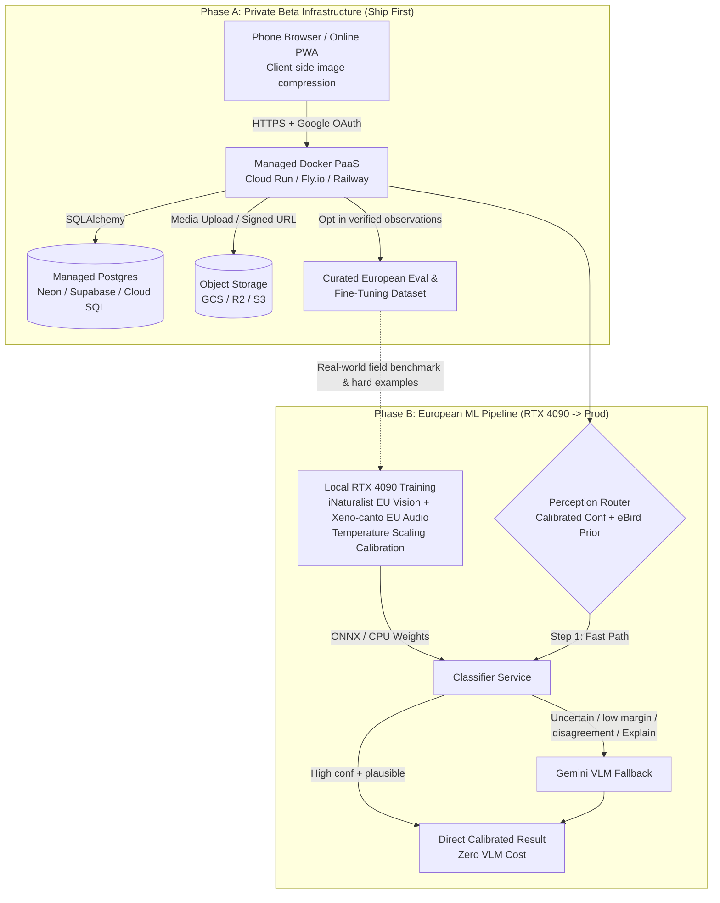

# Implementation Plan: Private Beta Launch & European ML Pipeline

## Goal Description
Evolve BirdAI into two tightly connected capabilities, executed in order:
1. **Phase A — Private Beta Launch (~5–50 real field users)**: Deploy the Stitch Live Field ID web app on a managed Docker PaaS with automatic HTTPS, persistent cloud storage, Google Sign-In OAuth + email allowlist, abuse protection, and an opt-in data flywheel so verified European field observations begin accumulating.
2. **Phase B — European ML Fine-Tuning & Deployment (RTX 4090 → Production)**: Fine-tune, calibrate, and deploy Europe-specific **vision** and **bioacoustic audio** classifiers, wired into BirdAI's perception engine as **classifier-first with Gemini fallback**.

---

## Design Decisions & Invariants

> [!IMPORTANT]
> **Execution Order**: Ship **Phase A** first while Gemini powers perception, so real European field observations and human corrections accumulate while Phase B models are trained on the local RTX 4090.

> [!IMPORTANT]
> **Privacy & Consent Invariant**: Beta user observations remain strictly private per user. Only users who explicitly enable the **opt-in consent toggle** (*"Allow my verified observations to help improve BirdAI models"*) have their verified observations included in evaluation/training exports.

> [!IMPORTANT]
> **Calibration Before Routing**: Classifier-first routing with Gemini fallback relies on **calibrated probabilities** (temperature scaling evaluated via ECE and Brier score), not raw softmax outputs.

---

## Pre-Phase A: Immediate Repository Cleanups
1. **Merge & clean `fix/ui-stitch-field-id`**: Bring the Stitch Live Field ID UI and end-to-end video support into `master`; remove stale deleted sample images (`kolibri*.JPG`, `tests/0ED7B8C7...`, `tests/1150_1.jpg`).
2. **Fix classifier defaults & Docker wiring**:
   - Default `CLASSIFIER_ENABLED=false` in `src/birdai/config.py` until a trained European checkpoint is deployed.
   - Pass `CLASSIFIER_SERVICE_URL=http://classifier:8000` and `CLASSIFIER_ENABLED=true` in `docker-compose.yml` for the `birdai` service so local multi-container runs connect properly.
3. **Retire legacy Gradio UI**: Remove `app.py`, `GradioUI.png`, `tests/test_app.py`, and `gradio` from `requirements-dev.txt`.

---

## Phase A: Private Beta Launch (Infra, Auth & Field UX)

### A1. Cloud Persistence (Postgres + Object Storage)
- **Database**: Migrate `src/birdai/db/` from local SQLite to **Managed Postgres** (Neon, Supabase, or Cloud SQL) via `DATABASE_URL` + Alembic migrations, keeping SQLite working for local tests.
- **Media Storage**: Abstract media read/write behind a storage interface (`LocalMediaStore` for dev/tests, `ObjectMediaStore` for GCS/R2/S3 in production) so container restarts never wipe uploads and verified media can be exported cleanly for ML training.

### A2. Auth, Access Control & Abuse Protection
- **Google Sign-In OAuth + Email Allowlist**:
  - Replace custom email/password registration with Google Sign-In OAuth (ID token / OAuth2 flow) gated by an `ALLOWED_BETA_EMAILS` allowlist (or DB allowlist table).
  - Issue signed session cookies / JWTs using a required non-default `JWT_SECRET_KEY` in production (fail fast on startup if default secret is used in prod).
- **Endpoint Hardening**:
  - Require authentication on `POST /api/extract-metadata`.
  - Enforce upload size caps (e.g., 10 MB images, 25 MB audio/video) with streaming/chunked writes instead of unbounded `await file.read()`.
  - Add per-user daily rate limits on Gemini-backed endpoints (`/api/observations`, `/api/chat`).

### A3. Data Flywheel (Opt-In Consent)
- Add `allow_model_training: bool = False` (plus `consent_updated_at`) to `UserModel`.
- Surface a clear profile toggle in the Stitch UI (*"Allow my verified observations to help improve BirdAI models"*).
- Add an export CLI script (`scripts/export_training_data.py`) that exports **only** opted-in, human-verified observations with metadata, labels, and media manifests for evaluation and fine-tuning.

### A4. Mobile Field UX (Online-Only PWA v1)
- Keep the Stitch frontend as an installable **online-only PWA** (`manifest.json`, icons, touch-friendly capture).
- Add **client-side image compression** (canvas resize/JPEG encode before upload, preserving extracted EXIF GPS/datetime via metadata payload) so weak wetland/forest cell signal uploads reliably.
- Defer offline IndexedDB queueing and background sync until beta users ask for it.

### A5. PaaS Deployment & CI/CD
- Deploy the FastAPI container to a managed Docker PaaS (**Google Cloud Run**, **Fly.io**, or **Railway**) with automatic HTTPS (required for mobile camera, microphone, and GPS APIs).
- Configure secrets via the platform secret manager (`GEMINI_API_KEY`, `EBIRD_API_KEY`, `DATABASE_URL`, `JWT_SECRET_KEY`, Google OAuth client credentials, object storage credentials).
- Extend `.github/workflows/ci.yml` with a manual or tag-triggered deploy job.

---

## Phase B: European ML Fine-Tuning & Deployment (RTX 4090 → Production)

### B1. European Bird Image Classifier
- **Dataset**: Replace CUB-200-2011 (mostly North American species) in `classifier_service/` with a **European / Swiss species dataset** (e.g., iNaturalist European Aves subset aligned to eBird taxonomy codes).
- **Training (RTX 4090, 24 GB VRAM)**:
  - Fine-tune and compare strong vision backbones (e.g., ConvNeXt-Tiny/Small, BioCLIP, or EVA-02) with class-balanced sampling, data augmentation, and `RankM` granularity diagnostics (`classifier_service/granularity/`).
  - Track experiments and store checkpoints in object storage / model registry rather than git.
- **Calibration**: Fit **temperature scaling** on a held-out European validation split; evaluate Top-1, Top-k, MRR, ECE, and Brier score (both on validation and on opted-in real field captures).
- **Serving**: Export to **ONNX** (or TorchScript) for low-latency CPU inference inside `classifier_service` on the managed PaaS.

### B2. European Bioacoustic Audio Classifier
- **Dataset**: Curate a European bird vocalization dataset from **Xeno-canto** (aligned to the same European eBird taxonomy codes as B1).
- **Modeling (RTX 4090)**:
  - Start with pretrained bioacoustic embeddings (**BirdNET** or **Google Perch**) + fine-tuned linear/MLP classification head (and optionally full backbone fine-tuning) over sliding audio windows.
  - Support both standalone audio uploads and audio tracks extracted from uploaded field videos.
  - Apply temperature scaling calibration on a held-out audio validation split.
- **Serving**: Expose `/predict-audio` alongside `/predict` in `classifier_service`.

### B3. Classifier-First Perception Routing with Gemini Fallback
Update `src/birdai/perception.py` to route observations intelligently:
1. Run the calibrated European image and/or audio classifier(s) first and combine with eBird regional plausibility (`src/birdai/plausibility.py`).
2. **Fast path (zero VLM cost)**: If top-1 calibrated confidence exceeds threshold $\tau_{\text{conf}}$, top-1/top-2 margin exceeds $\tau_{\text{margin}}$, and regional plausibility does not conflict, return the calibrated candidates and evidence directly.
3. **Gemini fallback**: Escalate to Gemini when:
   - Calibrated confidence or margin is below threshold,
   - Visual, audio, or eBird regional signals conflict,
   - Classifier service is unavailable or species is out-of-distribution, or
   - The user explicitly taps **"Explain with AI"** for a rich field-mark breakdown.
4. Log routing decisions (`fast_path` vs. `gemini_fallback` + reason) to evaluate latency, VLM cost savings, and accuracy side-by-side in `scripts/evaluate.py`.

---

## Verification Milestones
- **Pre-Phase A done**: `master` includes Stitch UI + video support, legacy Gradio removed, `pytest` and `ruff` green.
- **Phase A done**: Live HTTPS URL accessible on mobile; allowlisted beta users sign in with Google, upload compressed photos/audio/video, get persisted results in Postgres + Object Storage, and can toggle model-improvement opt-in.
- **Phase B done**: Calibrated European vision & audio classifiers deployed in `classifier_service`; `perception.py` routes high-confidence hits on the fast path and falls back to Gemini on uncertainty; `scripts/evaluate.py` reports Top-1/Top-k, MRR, ECE, Brier score, and fallback rate on real European field observations.
