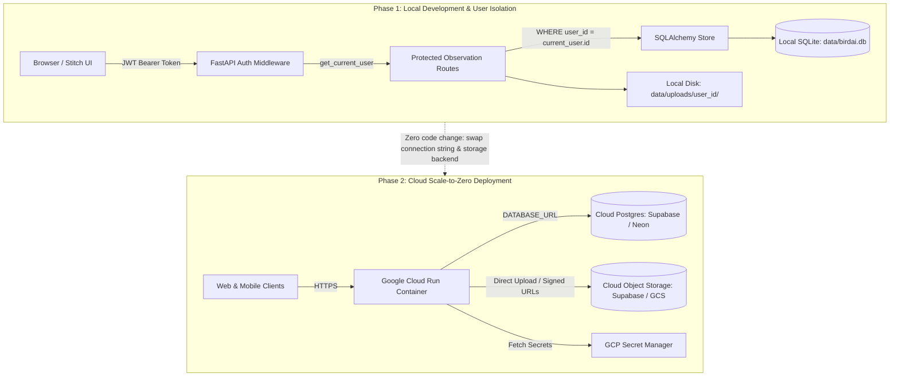

# Implementation Plan: Phased Database & Multi-User Security Architecture

## Goal Description
Transition BirdAI from simple local JSON files into a multi-user, secure application in two clean, decoupled phases:
- **Phase 1 (Local First)**: SQLite database via SQLAlchemy, JWT authentication, bcrypt password hashing, and strict private observation isolation per user on local/OrbStack.
- **Phase 2 (Cloud Production)**: Deployment to Google Cloud Run (scale-to-zero), connecting to a cloud database (Supabase/PostgreSQL) and cloud object storage (Supabase Storage or GCS) so data and media persist across container restarts.

---

## User Review Required

> [!IMPORTANT]
> **Observation Privacy Invariant**: All observations are **strictly private** to the authenticated user who created them. No user can view, edit, or delete another user's observation or access their uploaded images/audio. Unauthenticated requests are rejected with `401 Unauthorized`.

> [!IMPORTANT]
> **Decoupled Architecture**: Phase 1 is 100% self-contained and testable locally on macOS/OrbStack without registering any cloud accounts or spending money. Phase 2 simply switches `DATABASE_URL` from `sqlite:///./data/birdai.db` to PostgreSQL and swaps the media storage driver.

---

## Phase 1: Local SQLite + Multi-User Auth + Strict Privacy

### 1. Database & ORM (`src/birdai/db/`)

#### [NEW] `src/birdai/db/session.py`
- SQLAlchemy 2.0 engine configuration.
- Supports `sqlite:///./data/birdai.db` with WAL mode and `check_same_thread=False`.
- Dependency `get_db()` yielding a scoped database session.

#### [NEW] `src/birdai/db/models.py`
- `UserModel`:
  - `id` (UUID string, primary key)
  - `email` (string, unique, indexed)
  - `hashed_password` (string)
  - `full_name` (optional string)
  - `is_active` (boolean, default True)
  - `created_at` (datetime)
  - Relationship `observations` with cascade delete.
- `ObservationModel`:
  - `id` (string, e.g. `obs-xyz`, primary key)
  - `user_id` (foreign key `users.id`, indexed, non-nullable)
  - `created_at` (datetime)
  - `modality` (`image`, `audio`, `multimodal`)
  - `image_path` (string, relative or storage URI)
  - `audio_path` (string, relative or storage URI)
  - `context_json` (JSON)
  - `merlin_suggestion_json` (JSON, optional)
  - `candidates_json` (JSON: candidates + visual/audio/context evidence)
  - `overall_uncertainty` (string: low/medium/high)
  - `overall_uncertainty_reasons_json` (JSON list)
  - `suggested_next_action` (text)
  - `user_correction_json` (JSON, optional)
  - `local_classifier_json` (JSON, optional)

#### [NEW] `src/birdai/db/sql_store.py`
- Implements the `ObservationStore` protocol:
  - `save(record, user_id, files)`: Writes record and associates it with `user_id`.
  - `get(observation_id, user_id)`: Fetches record only if `observation.user_id == user_id`.
  - `update_correction(observation_id, correction, user_id)`: Enforces ownership before updating.
  - `list(user_id, limit, offset, reviewed_only)`: Enforces `WHERE user_id = :user_id`.

#### [NEW] `scripts/migrate_json_to_db.py`
- Reads existing JSON files in `data/observations/*.json`.
- Seeds a default user (e.g. `admin@birdai.local`) if no user exists.
- Inserts existing observations into SQLite without loss of metadata or review history.

---

### 2. Authentication & Security (`src/birdai/auth/`)

#### [NEW] `src/birdai/auth/security.py`
- `hash_password(password: str) -> str`: Uses `passlib` with `bcrypt`.
- `verify_password(plain_password: str, hashed_password: str) -> bool`.
- `create_access_token(data: dict, expires_delta: timedelta | None = None) -> str`: Signs JWT using `HS256` and `JWT_SECRET_KEY`.

#### [NEW] `src/birdai/auth/routes.py`
- `POST /api/auth/register`:
  - Payload: `{ "email": "user@example.com", "password": "...", "full_name": "..." }`.
  - Validates email uniqueness and minimum password strength (≥ 8 chars).
  - Returns `UserModel` response (excluding password hash).
- `POST /api/auth/token`:
  - OAuth2 standard form (`username` + `password`).
  - Verifies credentials, returns `{ "access_token": "...", "token_type": "bearer" }`.
- `GET /api/auth/me`:
  - Returns current logged-in user profile.

#### [NEW] `src/birdai/auth/dependencies.py`
- `get_current_user(token: str = Depends(oauth2_scheme), db: Session = Depends(get_db)) -> UserModel`:
  - Validates JWT signature, expiration, and user existence.
  - Raises `HTTPException(401)` if token is invalid or expired.

---

### 3. API Routes Update (`src/birdai/api/routes.py`)

- Inject `current_user: UserModel = Depends(get_current_user)` into:
  - `POST /api/observations`: Pass `current_user.id` to store; save files under `data/uploads/{current_user.id}/{obs_id}/`.
  - `GET /api/observations`: Return only `current_user`'s sightings.
  - `GET /api/observations/{id}`: Return 404 if observation does not belong to `current_user`.
  - `POST /api/observations/{id}/correct`: Prevent editing another user's observation.
  - `GET /api/media/{observation_id}/{filename}`: Enforce that the requesting user owns the observation.

---

### 4. Frontend UI Updates (`src/birdai/frontend/`)

- **Header User Bar**:
  - Unauthenticated: Display "Sign In / Register" button.
  - Authenticated: Display user avatar icon, user email, and "Sign Out" button.
- **Login / Register Modal**:
  - Clean modal matching BirdAI palette (`#123F2A`, `#547239`, `#9F2245`).
  - Tabs: "Sign In" and "Create Account".
- **Token Management in `app.js`**:
  - Store token in `localStorage.getItem("birdai_token")`.
  - Attach `Authorization: Bearer <token>` to all protected API calls.
  - Redirect/prompt sign-in automatically when receiving a `401 Unauthorized` response.

---

## Phase 2: Cloud Deployment (Cloud Run + Cloud DB + Cloud Storage)

### 1. Cloud Database Connection
- Set `DATABASE_URL=postgresql+psycopg://postgres:<PASSWORD>@<HOST>:5432/postgres` in the environment.
- Because SQLAlchemy abstracts SQL dialects, **zero code changes** are needed in the ORM models or stores to switch from SQLite to PostgreSQL (Supabase / Neon).
- Connection pool tuning for serverless scale-to-zero (`pool_size=5`, `max_overflow=10`, `pool_pre_ping=True`).

### 2. Cloud Object Storage Driver (`src/birdai/storage.py`)
- Create `CloudStorageStore` implementing `MediaStorageDriver`:
  - If `STORAGE_BACKEND=supabase`: uploads files using `supabase-py` storage client.
  - If `STORAGE_BACKEND=gcs`: uploads files using `google-cloud-storage` client.
  - If `STORAGE_BACKEND=local`: preserves current local disk storage (default for dev).
- Media URLs become public signed URLs (e.g. `https://<project>.supabase.co/storage/v1/object/public/photos/...`) instead of container-local paths.

### 3. Container & Secret Configuration
- `Dockerfile`: Multi-stage, minimal distroless or slim Debian image.
- `cloudbuild.yaml` or `gcloud run deploy`:
  - Service: `birdai-service`.
  - CPU: 1 vCPU, Memory: 1 GiB.
  - Scaling: Min instances = 0 (scale to zero: \$0 cost), Max instances = 5.
  - Secrets mapped from GCP Secret Manager:
    - `GEMINI_API_KEY`
    - `JWT_SECRET_KEY`
    - `DATABASE_URL`

---

## Testing Strategy for Both Phases

### Phase 1 Test Suite

#### 1. Unit & Auth Tests (`tests/test_auth.py`)
- `test_hash_and_verify_password`:
  - Confirms bcrypt hashing creates valid hashes and rejects incorrect passwords.
- `test_create_and_decode_jwt_token`:
  - Confirms token generation encodes user ID and expiration, and rejects tampered or expired tokens.
- `test_register_new_user`:
  - Registers a user via `POST /api/auth/register`, verifies 201 response and hashed password storage.
- `test_register_duplicate_email_fails`:
  - Asserts 400 status when attempting to register an existing email.
- `test_login_success_returns_jwt`:
  - Submits valid credentials to `POST /api/auth/token`, asserts `access_token` returned.
- `test_login_invalid_password_rejected`:
  - Asserts 401 when submitting wrong password.

#### 2. SQL Store & Privacy Isolation Tests (`tests/test_sql_store.py`)
- `test_sql_store_save_and_get`:
  - Saves an observation in an in-memory SQLite database, verifies all fields, candidates, and evidence are correctly stored.
- `test_user_cannot_read_another_users_observation`:
  - User A creates an observation.
  - User B queries `GET /api/observations/{id}` with User B's token.
  - Asserts `404 Not Found` (or `403 Forbidden`).
- `test_user_cannot_list_another_users_observations`:
  - User A has 3 observations, User B has 1 observation.
  - Listing observations as User B returns exactly 1 observation; User A's observations are excluded.
- `test_user_cannot_correct_another_users_observation`:
  - User B attempts `POST /api/observations/{user_a_obs_id}/correct`.
  - Asserts 404/403 and ensures the record was not modified.
- `test_media_endpoint_requires_owner_token`:
  - Asserts `GET /api/media/{id}/{file}` returns 401/403 when requested without owner authorization.

#### 3. Migration Test (`tests/test_migration.py`)
- `test_migrate_legacy_json_to_sqlite`:
  - Creates temporary directory with sample legacy JSON records.
  - Runs `migrate_json_to_db` script.
  - Verifies all records exist in SQLite and map to the designated admin user.

#### 4. Regression Test
- Run `PYTHONPATH=src pytest tests/` to confirm all 50 existing tests continue to pass.

---

### Phase 2 Test Suite

#### 1. Cloud Storage Driver Tests (`tests/test_cloud_storage.py`)
- `test_cloud_storage_driver_local_fallback`:
  - Verifies local file storage operates transparently when `STORAGE_BACKEND=local`.
- `test_cloud_storage_driver_upload_and_get_url`:
  - Uses mocked Supabase/GCS client to verify upload streams bytes, handles mime-types, and returns secure remote URL.
- `test_cloud_storage_delete_on_cascade`:
  - Verifies deleting an observation also dispatches deletion of associated media blobs.

#### 2. Database Compatibility Tests (`tests/test_db_postgres.py`)
- `test_schema_ddl_compatible_with_postgres_types`:
  - Uses `SQLAlchemy` engine connected to SQLite with Postgres JSON dialect checks to verify models don't use SQLite-only quirks.

#### 3. Container Health & Cold Start Verification
- Build Docker container locally with OrbStack:
  `docker build -t birdai:phase2 .`
- Run container locally with test environment:
  `docker run -p 8080:8080 -e DATABASE_URL=sqlite:///data/test.db birdai:phase2`
- Run HTTP health check `GET http://localhost:8080/health` (assert `< 200ms` response).
