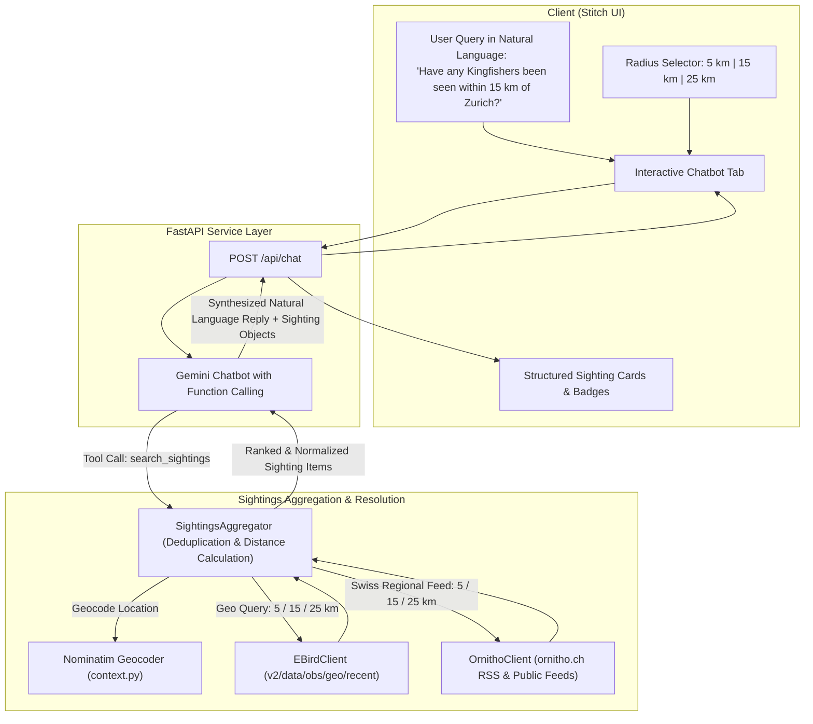

# Implementation Plan: Natural Language Bird Sightings Chatbot (eBird + ornitho.ch)

## Goal Description
Build an intelligent natural language chatbot in BirdAI that allows users to query recent bird sightings, discover which species have been seen recently, or search for a specific bird in any region within configurable radiuses (**5 km, 15 km, or 25 km**), synthesizing real-time data from both **eBird API v2** and **ornitho.ch**.



---

## User Review Required

> [!IMPORTANT]
> **Radius Clamping (5 km, 15 km, 25 km)**: The chatbot will support auto-extracting the radius from natural language (e.g. *"within 5 km"*, *"in the last 15 km"*), defaulting to **15 km** when unspecified, with quick-select toggle pills (5 km, 15 km, 25 km) in the chat interface.

> [!IMPORTANT]
> **Dual-Source Attribution**: Sightings will clearly indicate whether they originated from **eBird** or **ornitho.ch**, preserving the observer's timestamp, distance from target location, count, and links to source checklists where available.

---

## Open Questions

> [!NOTE]
> 1. **Default Location**: When a user asks *"What birds were seen around here?"* without specifying a city, should the chatbot fall back to the browser's current GPS coordinates or the configured `BIRDAI_LOCATION` (Zurich, Switzerland)? (Recommended: Browser GPS first if permitted, fallback to `BIRDAI_LOCATION`).
> 2. **Chat History Persistence**: Should chat conversations be stored in the SQLite database per user so you can review previous conversations, or remain ephemeral in the browser session? (Recommended: Keep in browser state for MVP, add DB persistence later).

---

## Proposed Changes

### 1. Data Models & Schemas (`src/birdai/schemas.py`)

#### [MODIFY] `src/birdai/schemas.py`
Add schemas for sightings and chat messages:

```python
class SightingItem(BaseModel):
    species_common_name: str
    species_scientific_name: Optional[str] = None
    count: Optional[int] = 1
    observed_at: str  # ISO datetime or date string
    location_name: str
    latitude: float
    longitude: float
    distance_km: float
    source: Literal["ebird", "ornitho.ch"]
    checklist_url: Optional[str] = None
    notable: bool = False

class ChatMessage(BaseModel):
    role: Literal["user", "assistant", "system"]
    content: str
    sightings: Optional[list[SightingItem]] = None
    timestamp: Optional[datetime] = None

class ChatRequest(BaseModel):
    message: str
    conversation_history: list[ChatMessage] = []
    user_latitude: Optional[float] = None
    user_longitude: Optional[float] = None
    preferred_radius_km: Optional[Literal[5, 15, 25]] = 15

class ChatResponse(BaseModel):
    reply: str
    sightings: list[SightingItem] = []
    parsed_query: dict[str, Any]  # { "location": "Zurich", "radius_km": 15, "species": "Kingfisher" }
```

---

### 2. Sighting Data Sources (`src/birdai/`)

#### [MODIFY] `src/birdai/ebird_client.py`
Extend `EBirdClient` to query any species or all recent species within 5, 15, or 25 km:
- `recent_sightings_in_radius(lat: float, lng: float, dist_km: int = 15, back_days: int = 7, max_results: int = 50) -> list[SightingItem]`
  - Calls `GET /v2/data/obs/geo/recent`
- `recent_species_sightings_in_radius(species_code: str, lat: float, lng: float, dist_km: int = 15, back_days: int = 7, max_results: int = 50) -> list[SightingItem]`
  - Calls `GET /v2/data/obs/geo/recent/{speciesCode}`
- `recent_notable_sightings_in_radius(lat: float, lng: float, dist_km: int = 15, back_days: int = 7) -> list[SightingItem]`
  - Calls `GET /v2/data/obs/geo/recent/notable`

#### [NEW] `src/birdai/ornitho_client.py`
Ornitho.ch integration client:
- Fetches and parses the public RSS feed (`https://www.ornitho.ch/index.php?m_id=1202&sp_tg=1&rss=1`) for Swiss bird sightings.
- Extracts species name, date/time, count, locality/canton, and coordinates.
- Computes Haversine distance from queried coordinates.
- Filters sightings within the requested radius (5 km, 15 km, or 25 km).
- Returns no ornitho.ch results when the feed is offline or rate-limited (no placeholder data); records with unknown locations are skipped.

#### [NEW] `src/birdai/sightings_aggregator.py`
Aggregates and deduplicates sightings from eBird and ornitho.ch:
- `search_sightings(location_name: str, radius_km: int = 15, species_name: str | None = None, back_days: int = 7, lat: float | None = None, lng: float | None = None) -> list[SightingItem]`
  - Resolves location coordinates via `geocode_location` if not provided.
  - Queries `EBirdClient` and `OrnithoClient` concurrently.
  - Computes exact `distance_km` from center point for every sighting.
  - Filters strictly to `distance_km <= radius_km` (5, 15, or 25 km).
  - Sorts sightings by recency (newest first) and distance.

---

### 3. Chatbot Agent Engine (`src/birdai/chat_agent.py`)

#### [NEW] `src/birdai/chat_agent.py`
Gemini-powered naturalist assistant with tool calling:
- Defines the `search_sightings` function declaration for Gemini:
  ```json
  {
    "name": "search_sightings",
    "description": "Search recent bird sightings within 5km, 15km, or 25km of a location using eBird and ornitho.ch.",
    "parameters": {
      "location": "City, town, landmark, or region (e.g. Zurich, Lake Geneva)",
      "radius_km": "Distance radius: 5, 15, or 25 (default 15)",
      "species_name": "Optional bird species common or scientific name",
      "back_days": "Days to look back (default 7)"
    }
  }
  ```
- Uses `generate_content_with_fallback` (with our 3.5 -> 2.5 fallback chain).
- Conversational system prompt instructing the agent to provide helpful naturalist context, compare eBird vs ornitho.ch records, and offer advice on where to spot the bird.

---

### 4. API Endpoints (`src/birdai/api/routes.py`)

#### [MODIFY] `src/birdai/api/routes.py`
Add chat and sightings endpoints:
- `POST /api/chat`: Runs natural language chat query, calls agent, and returns synthesized text + structured `SightingItem` cards.
- `GET /api/sightings/recent`: Direct REST query endpoint for sightings (`?location=Zurich&radius_km=15&species=Robin`).

---

### 5. Frontend Chat UI (`src/birdai/frontend/`)

#### [MODIFY] `src/birdai/frontend/index.html`
- Add third navigation tab: `<button id="nav-chat" class="nav-btn">🔭 Sightings Chat</button>`.
- Add `#chat-view` section:
  - Header with quick radius selector: `[5 km] [15 km (Default)] [25 km]`.
  - Chat message timeline.
  - Suggested query chips:
    - *"Kingfishers within 15 km of Zurich"*
    - *"What birds were seen in Bern this week (5 km)?"*
    - *"Rare bird sightings in Switzerland (25 km)"*
    - *"Red Kite near Lake Geneva"*
  - Chat input box with send button and location detection button.
  - Interactive sighting cards embedded under assistant replies.

#### [MODIFY] `src/birdai/frontend/app.js` & `styles.css`
- Chat controller logic, message streaming/rendering, quick chip click handlers.
- Sighting cards styling with source tags: `[eBird]` (blue pill), `[ornitho.ch]` (green pill).

---

## Verification Plan

### Automated Tests
1. **eBird Extended Endpoints** (`tests/test_ebird_client.py`):
   - Test geo recent sightings query with distance radius (5, 15, 25 km).
   - Test geo species search with `species_code`.
2. **Ornitho Client** (`tests/test_ornitho_client.py`):
   - Parse sample ornitho.ch RSS XML into structured `SightingItem` records.
   - Test coordinate distance calculation and radius filtering.
3. **Sightings Aggregator** (`tests/test_sightings_aggregator.py`):
   - Test merging results from eBird and ornitho.ch.
   - Verify distance clamping (e.g. observations > 15 km are excluded when 15 km is requested).
4. **Chatbot Agent Engine** (`tests/test_chat_agent.py`):
   - Mock Gemini function call returning tool arguments `{location: "Zurich", radius_km: 15, species_name: "Alcedo atthis"}`.
   - Verify tool execution and conversational synthesis.
5. **API Chat Endpoint** (`tests/test_api_chat.py`):
   - Test `POST /api/chat` with mock response.
6. **Full Test Suite**:
   - Confirm all 57 existing tests continue to pass (`PYTHONPATH=src pytest tests/`).

### Manual Verification
1. Open [http://localhost:8080](http://localhost:8080) and click **Sightings Chat**.
2. Select **15 km** and type: *"What birds have been spotted around Zurich recently?"*.
3. Verify assistant returns a natural answer and renders cards with distance and source badges.
4. Type: *"Have any Kingfishers been seen within 5 km?"*. Verify radius filters to 5 km.
